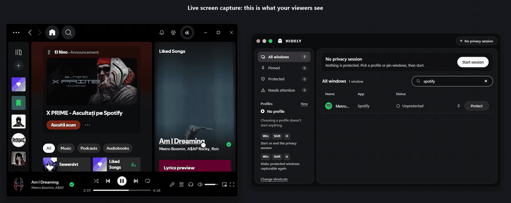
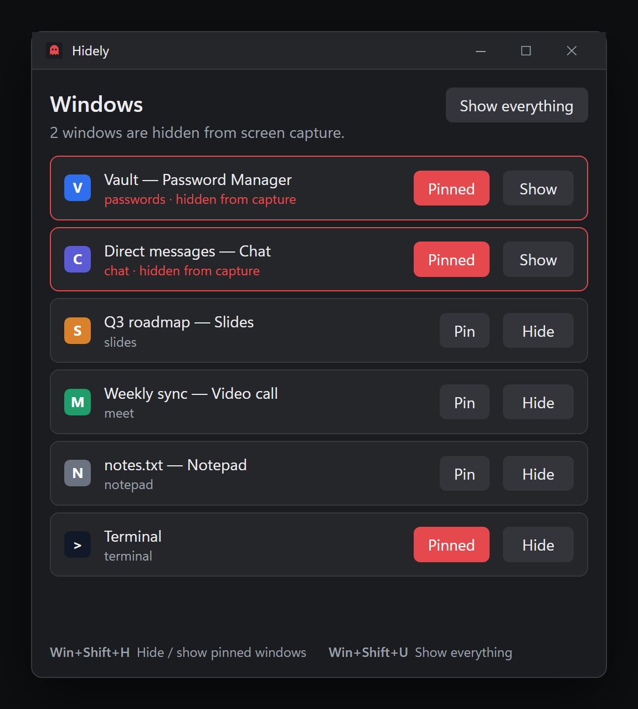

<p align="center">
  
</p>

<h1 align="center">Hidely</h1>

<p align="center">
  Hide any window from screen sharing, recordings and screenshots.<br />
  You still see it. Your viewers don't.
</p>

<p align="center">
  <a href="https://github.com/CodingRule/Hidely/actions/workflows/ci.yml"></a>
  
  
  <a href="LICENSE"></a>
</p>

<p align="center">
  <a href="https://github.com/CodingRule/Hidely/releases/latest"><strong>Download</strong></a> ·
  <a href="https://codingrule.github.io/Hidely/"><strong>Test page</strong></a> ·
  <a href="#how-it-works">How it works</a> ·
  <a href="#roadmap">Roadmap</a>
</p>

<p align="center">
  <strong>Built on <a href="https://github.com/ahossu/DWMShield">DWMShield</a> by Alexandru Hossu (<a href="https://github.com/ahossu">@ahossu</a>).</strong><br />
  Alexandru Hossu discovered the technique this project grew out of, and his kernel driver is<br />
  included in <a href="driver/"><code>driver/</code></a> with permission, under its own MIT licence.
</p>

<p align="center">
  
</p>

You are sharing your screen in a meeting and need to check your password manager, a private chat
or a terminal. Normally everyone watching sees it too. With Hidely, you choose the windows that
are private and start a privacy session. Hidely asks Windows to leave those windows out of screen
capture, while they stay fully visible and usable on your own monitor.

Hidely lives in the system tray, needs no driver and no administrator rights for ordinary apps,
and puts things back the way it found them when the session ends.

Capture protection is not a guarantee against every recording method. What a given meeting app
shows depends on how it captures the screen, so check yours with the [test page](#download) and
see the [compatibility record](docs/COMPATIBILITY.md) for what has actually been tested.

## Features

- **Privacy sessions.** Protection has a clear start and end. Ending a session makes every window Hidely changed capturable again.
- **Meeting profiles.** Save sets of apps such as Work, Client demo or Streaming. Before a session starts, Hidely shows which apps it will affect and which are not running.
- **New windows are covered.** During a session with a profile, windows those apps open later are protected too. A new window can be captured for a moment first; see [measured behaviour](docs/COMPATIBILITY.md#measured-behaviour).
- **Honest status.** Each window is Unprotected, Applying, Protection applied, Unsupported or Error, in words and a distinct icon. "Protection applied" is only shown after Windows confirms the setting, and failures say why.
- **Pins and manual control.** Protect a single window at any time, or pin windows to include them when a session starts.
- **Shortcuts you can change.** <kbd>Win</kbd> + <kbd>Shift</kbd> + <kbd>H</kbd> starts or ends a session and <kbd>Win</kbd> + <kbd>Shift</kbd> + <kbd>U</kbd> makes everything capturable again, by default. If a new combination is taken, the old one keeps working.
- **Works from the tray.** Start, end and restore from the tray menu with the window closed. The tooltip says in words what is protected.
- **Private HUD.** A small on-screen confirmation that is itself excluded from capture.
- **Plain pointer over protected windows.** Captures still draw the mouse pointer over a window they leave out. While it is over a protected window, Hidely keeps it a plain arrow, so a text bar or a hand can't give the window away.
- **Recovery.** If Hidely crashes it restores windows on the way down. If it is killed outright, the next launch restores them and tells you.
- **Local diagnostics.** An optional report you read before saving. It has no window titles, paths or screenshots and is never uploaded.
- **32-bit and 64-bit apps.** Both are supported.
- **CLI included.** `hidely-cli watch slack.exe` runs a session from a terminal.

<p align="center">
  
</p>

## Download

**[Download the latest release](https://github.com/CodingRule/Hidely/releases/latest)** for
Windows 10 (version 2004 or later) and Windows 11, 64-bit. No Rust, Node or other developer tools
needed.

- **`Hidely_x.y.z_x64-setup.exe`** is the installer. It sets up everything Hidely needs,
  including Microsoft's WebView2 runtime if your PC doesn't have it.
- **`Hidely_x.y.z_x64-portable.exe`** is a single file you can run without installing.

Hidely is Windows-only. It is built on a Windows capture-exclusion feature that macOS and Linux
don't offer, so there is nothing to build or run on those systems.

The downloads are not code-signed yet, so Windows shows a "Windows protected your PC" warning the
first time. Choose **More info**, then **Run anyway**.

Then open the **[test page](https://codingrule.github.io/Hidely/)**. It opens a harmless test
window, shows you your own screen share, and lets you see whether a protected window is left out
of it. That preview verifies the capture method you picked in that browser only, so repeat the
check in the preview of each meeting app you use. Nothing from the test page is recorded or
uploaded.

## Build from source

### 1. Build and run

You need [Rust](https://rustup.rs) (stable, MSVC toolchain), [Node.js](https://nodejs.org) 18+ and
the [WebView2 runtime](https://developer.microsoft.com/microsoft-edge/webview2/) (already present
on Windows 11).

```powershell
git clone https://github.com/CodingRule/Hidely
cd Hidely
npm install
npm run dev
```

`npm run build` produces an installer in `target/release/bundle/nsis/`.

### 2. Run the test page locally

The test page lives in [`docs/index.html`](docs/index.html). Screen sharing needs a secure
origin, so serve it instead of opening the file:

```powershell
npx http-server docs -p 4173
```

Then open <http://localhost:4173>.

### 3. Cut a release

Bump the version in `src-tauri/tauri.conf.json` and `Cargo.toml`, update
`.github/release-notes.md`, then push a tag such as `v0.2.0`. The release workflow builds the
installer and publishes it.

## Using Hidely

| I want to… | Do this |
|---|---|
| Protect one window right now | Click **Protect** next to it. This starts a session if none is running. |
| Protect the same apps every time | Click **New** under Profiles, tick the apps, save, and select the profile |
| Start a session | Click **Start session** (or press <kbd>Win</kbd> + <kbd>Shift</kbd> + <kbd>H</kbd>), read what it will affect, and confirm |
| Include a specific window | Click its pin before starting. Pinned windows are protected when a session starts. |
| End the session | Click **End session**, or press <kbd>Win</kbd> + <kbd>Shift</kbd> + <kbd>H</kbd> again |
| Make everything capturable again, now | Press <kbd>Win</kbd> + <kbd>Shift</kbd> + <kbd>U</kbd> |
| Change the shortcuts | Click **Change shortcuts** at the bottom left |
| Keep it out of the way | Close the window. Hidely stays in the tray. |
| Quit | Right-click the tray icon and choose **Quit** |

### Command line

```text
hidely-cli list                      List windows (* = excluded from capture)
hidely-cli hide <target>             Exclude matching windows from capture
hidely-cli show <target>             Make matching windows capturable again
hidely-cli restore                   Make everything Hidely changed capturable again
hidely-cli watch <exe>... [--seconds N]
                                     Run a privacy session for these programs,
                                     including windows they open while it runs
```

`<target>` is a window handle such as `0x1A2B3C` or a process name such as `notepad`.
`<exe>` is a whole executable file name such as `notepad.exe`.

The app itself also takes two arguments, which are passed to the copy that is already running:
`Hidely.exe --toggle-session` starts or ends a session with the selected profile and pinned
windows, and `Hidely.exe --end-session` makes everything capturable again.
Build it with `cargo build --release -p hidely-cli`.

## How it works

Windows has a documented switch for this:
[`SetWindowDisplayAffinity(hwnd, WDA_EXCLUDEFROMCAPTURE)`](https://learn.microsoft.com/windows/win32/api/winuser/nf-winuser-setwindowdisplayaffinity).
Windows then leaves that window out of screen capture. Password managers use it on their own
windows.

The catch is that Windows only accepts the call from the process that owns the window. So for
another app's window, Hidely makes the call from inside that app:

1. It writes a 36-byte stub into the target process that does one thing: call
   `SetWindowDisplayAffinity` for that window.
2. It runs the stub on a short-lived thread and reads back whether Windows accepted it.
3. It frees the memory again. No DLL stays loaded and nothing in the app is patched.
4. It asks Windows what the window's setting is now. Only if that matches is the window shown
   as "Protection applied".

The whole mechanism is about 150 lines in
[`crates/hidely-core/src/inject.rs`](crates/hidely-core/src/inject.rs).

```text
ui/                  Front end (plain HTML, CSS, JS)
src-tauri/           Tauri 2 app: tray, shortcuts, HUD, commands
crates/hidely-core/  The engine: windows, sessions, profiles, capture exclusion (Win32)
crates/hidely-cli/   Command-line front end over the same engine
docs/                Test page, compatibility record, driver notes
driver/              DWMShield kernel driver (optional, not built; see below)
```

## Limits you should know about

- **Not every app has been tested.** The three main Windows capture methods and screen sharing in Chrome and Edge are confirmed; Zoom, Teams, Discord and OBS are not yet. The [compatibility record](docs/COMPATIBILITY.md) lists exactly what was checked and how. Treat anything else as unknown until you have looked at it yourself.
- **A new window can be seen briefly.** During a session, a window an app opens can appear in a capture for a moment before Hidely protects it (0 to 139 ms in our measurements).
- **Don't use it on games with anti-cheat.** Hidely has to run a call inside the app it protects, and anti-cheat software treats that as tampering. It may block the change (Hidely then shows an Error), and it could flag your account. Roblox blocked it in our one observation.
- **Apps running as administrator need Hidely to be too.** Hidely reports them as an Error otherwise. Use **Restart as administrator** at the bottom left; Windows will ask you to approve.
- **Protected processes can't be changed** in user mode. That is what the optional kernel driver is for.
- **A forced kill leaves windows protected** until Hidely is started again or the app is reopened.
- **The plain pointer applies to you too.** While the pointer is over a protected window you also see an arrow instead of a text bar or hand. Apps that draw their own custom pointers are not affected. If Hidely is killed at that moment, pointers stay plain until Hidely starts again or you sign out.
- **Antivirus may object.** Writing into another process is also what malware does, so some security products flag or block it. The code is short and open so you can check what it does.
- **It only affects screen capture.** Hidely does not conceal a window from someone looking at your monitor, from software that reads window titles or lists running programs, or from an administrator of the machine.
- **Shortcuts can be taken.** If another app already owns a combination, Hidely says so and lets you pick another.

## Roadmap

Released:

- [x] **v0.1** Tray app, window list, pins, shortcuts, restore on exit
- [x] **v0.2** Privacy sessions, meeting profiles, rules for new windows, honest status, configurable shortcuts, diagnostics
- [x] **v0.2.1** 32-bit apps, apps running as administrator, and capture methods and browsers tested for the compatibility record

Next:

- [ ] **v0.3** Zoom, Teams, Discord, OBS and Firefox checked for the [compatibility record](docs/COMPATIBILITY.md). Help wanted: [issue 1](https://github.com/CodingRule/Hidely/issues/1)
- [ ] **v0.4** Browser extension for per-tab hiding
- [ ] **v1.0** Signed installer and auto-update

Not planned for now:

- Optional kernel driver for protected processes. It is not built or tested; [docs/DRIVER.md](docs/DRIVER.md) explains why.

## Contributing

Issues and pull requests are welcome, and you don't need to write code to help: testing Hidely
with a meeting app you already use is the most useful thing right now. See the
[good first issues](https://github.com/CodingRule/Hidely/issues?q=is%3Aissue+is%3Aopen+label%3A%22good+first+issue%22).
[CONTRIBUTING.md](CONTRIBUTING.md) explains where to start, how to set up, what to check before
a pull request, and where things live. Changes are listed in the
[changelog](CHANGELOG.md).

Found a security problem? Please report it privately as described in [SECURITY.md](SECURITY.md).

## Responsible use

Hidely is for your own privacy on your own computer: keeping your password manager, messages and
notes out of a screen share. Do not use it to get around monitoring you have agreed to, such as
exam proctoring or workplace policy, or on machines you are not allowed to modify.

## Credits

- [DWMShield](https://github.com/ahossu/DWMShield) by Alexandru Hossu
  ([@ahossu](https://github.com/ahossu)), who discovered the technique and whose kernel driver is included in [`driver/`](driver/) with
  permission, under its own MIT licence. Hidely exists because of his work.
- [Tauri](https://tauri.app) for the app shell.

## License

[MIT](LICENSE) © 2026 Elure
